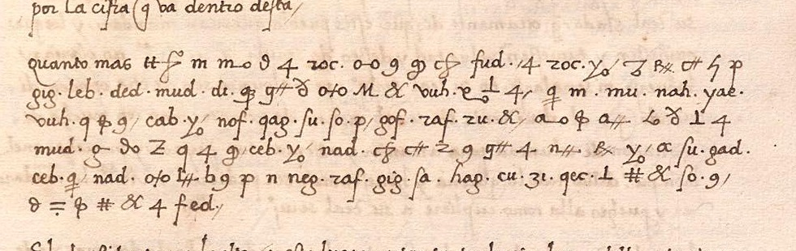

# The cipher paragraph in Adrian of Utrecht's letter to Charles V, 9 September 1520

Devin O'Keefe, October 2026. Not peer-reviewed.



*España, Ministerio de Cultura, Archivo General de Simancas, PTR,LEG,2,1,19, first page (detail). From PARES,
the Spanish archives' portal, <https://pares.cultura.gob.es/ParesBusquedas20/catalogo/description/12987122>.*

In September 1520 Castile was in revolt. Charles V had sailed for the Low Countries in May and left his former
tutor Adrian of Utrecht, cardinal and bishop of Tortosa, to govern in his place. Adrian wrote to him from
Valladolid about once a week as one town after another went over to the rebellion of the towns, the
Comunidades. Six lines of his letter of 9 September are in cipher, and both printed editions leave them out:
Constantin von Höfler (1881) marks them as missing, and Manuel Danvila (1898) notes that the paragraph "could
not be translated".

Read with the key described below, the six lines have the cardinal tell the king that what the rebels are
doing may itself prove the cure, because they are moving against the grandees as well as against the Crown:
they mean to take from the grandees first their sales-tax revenues and then the towns that had lately been the
Crown's.

## What it says

> {Quanto mas} quiça esto dara remedio a estos males, que no solamente se mueven contra su Magestad mas ahun
> contra todos los grandes, dels quales entienden primeramente quitar todas las alcavalas y despues todas las
> villas y lugares que de poco tiempo aca fueron de la corona real.

> Perhaps this will bring a remedy to these ills, for they are rising not only against His Majesty but against
> all the grandees as well, from whom they mean to take first all the alcabalas and afterwards all the towns
> and villages that not long ago belonged to the royal Crown.

The translation omits the two words in braces, which stand in clear at the head of the paragraph
([docs/METHOD.md](docs/METHOD.md#words-in-clear-within-the-cipher) gives the reasons). Read as part of the
text, they would make the sentence "all the more since this will perhaps bring a remedy".

The alcabala was the Castilian sales tax, a royal revenue that in many lordships had passed to the lord by
grant or by usurpation. The towns and villages are presumably those that had lately passed from the Crown to
the nobility.

The lines before the paragraph, which are in clear, report that the rebels at Plasencia are withholding the
royal revenues, and end: "what they aim at in this Your Highness will learn from the cipher that goes inside
this letter" (*por la cifra que va dentro desta*; Danvila, vol. 2, p. 18). Those words may mean these six
lines or a separate sheet that is no longer with the letter, since the letter of 1 October 1520 uses them of
an enclosure. Earlier in the letter the cardinal says he could wish matters were already at their worst, so
that there might afterwards be hope of improvement (p. 17), and the cipher paragraph gives a reason for that
hope. The revolt was turning on the lords that September, when the town of Dueñas rose one Sunday night
against the Count of Buendía (Danvila, vol. 2, p. 146), and a movement that threatened the grandees' own
revenues could be expected to bring them over to the king.

After the defeat of the Comunidades at Villalar in April 1521 the cardinal came back to the point twice. In
the first cipher paragraph of his letter of 23 May he wrote that the grandees had served the king in the
campaign "not only for your service but also for the fear they had of the comunidades, for these meant to take
their lands from them and bring them back to the Crown" (*no solamente por vuestro seruicio mas ahun por temor
que ternian a las comunidades ca tenian proposito de tomarles sus tierras y reducirlas a la Corona*; Danvila,
vol. 4, p. 26), with the turn *no solamente ... mas ahun* of the paragraph. Writing from Logroño on 14 August
1521, he reported, in a passage that Danvila does not mark as cipher, the common opinion that the grandees
would not have opposed the rebels so readily had the rebels not set out to harm them, "above all in wanting to
take the alcabalas from them" (*mayormente en quererles quitar las alcaualas*; Danvila, vol. 4, p. 379), with
the verb and the noun of the cipher paragraph.

The paragraph has 48 words. The first two, *quanto mas*, are in clear, that is, in ordinary writing. The other
46 are in cipher and are read with values found outside the paragraph. The division into words, the capitals
and the two commas are editorial, as is the choice between c and ç, u and v, i and y, which the cipher does
not distinguish. [docs/TEXT.md](docs/TEXT.md) gives the paragraph sign by sign, with notes on the text.

## How the cipher works

The cipher is a nomenclator, a cipher alphabet combined with a small code. The name of the clerk who
enciphered the letter is not known.

- Each letter has from one to seven signs, and the clerk moves among them. In the first line the word *dara*
  is written with four signs, and the two that stand for *a* are different.
- Common words and syllables have groups of two or three ordinary letters closed by a dot: `gig.` is *que*,
  `leb.` is *no*, `roc.` is *esto*.
- Endings are added to a group with letter signs: `roc.` + s is *estos*, and `qec.` (*fue*) + r-o-n is
  *fueron*.
- The clerk closes some words with a stroke, shown here as a slash, most often words that end in a letter
  sign.

This is the first line of the paragraph, with the two words the clerk left in clear. The letter signs are
shown by the letters they stand for, although on the page they look nothing like them:

```
quanto mas   q-u-i-ç-a   roc.   d-a-r-a   fud.      /   a   roc. + s   /   m-a-l-e-s
quanto mas   quiça       esto   dara      remedio       a   estos          males
```

Olga Kolosova's doctoral thesis on the ciphers of Charles V's diplomacy, which reconstructs this cipher, says
that the secretaries compiled such vocabularies in the alphabetical order of their words, and notes for this
cipher that the first letter of a group can show the first letter of the word. The shorter version of the
thesis in the University of Valencia's repository shows the groups of another cipher of the period, found in
the letters of Lope Hurtado, assigned from z backwards. Here too, Kolosova's groups and the ones added in this
study go backwards through the consonants as the words go forwards through the alphabet: words in a- have
groups in z- and y-, words in d- have groups in s-, and so on down to *ya*, which has a group in b-. A group
that is not in the key can therefore usually be placed within a few letters of the alphabet before its value
is known.

## How it was read

### The key

Kolosova rebuilt the cipher from letters that Adrian wrote to Charles from Rome in 1522 and 1523, after he had
become pope, and the thesis gives a table of 65 letter signs and a vocabulary of 92 entries. In September 2026
Satoshi Tomokiyo suggested that some groups which Dan Bourdeau had noticed in the cardinal's Simancas letters
of late 1521 belong to that vocabulary. On the images, three of those letters (PTR,LEG,2,1,99, 100 and 101)
and the undated sheet filed with no. 100, which Bourdeau's notes also list, prove to be in the same cipher, as
does the paragraph of 1520, the earliest use of the cipher found so far. The archive's catalogue, which
describes the letter as partly in cipher, pointed to it.

Kolosova's key reads most of the paragraph but leaves gaps. Of the 29 different groups in it, 19 are in the
vocabulary of the thesis, `mu.` (*Magestad*) only as part of the pair `cim. mu.`, *vuestra Magestad*, and 10
are missing. Since `cim.` alone is *vuestra* in the vocabulary, `mu.` alone is read as *Magestad*. The thesis
also gives no sign for the letter q.

The ten groups were found in four of the cardinal's letters of 1521, in the same bundle (*legajo*) at
Simancas, which are called A to D here: A, of 5 December; B, an undated sheet filed with no. 100, whose text
is that of the cipher paragraphs of the letter of 24 October; C, of 7 December; and D, a cipher paragraph of
May. For A and C a decipherment made at the time is filed with the letter, and for B and D Danvila prints the
deciphered text. Set side by side, cipher and deciphered text give the value of most of the groups in those
passages. In this way `fud.` stands where the text has *verdadero remedio*, `ded.` in *en una sola cosa*,
`cu.` three times for *tiempo*, and `ru.` + n three times for *entienden*. The comparison added 63 groups to
the vocabulary, the ten among them, and showed two signs for q, one of which begins *quiça* in the paragraph
and the other *quitar*. A crop of every line that the evidence names is in `images/parallels/`
([docs/METHOD.md](docs/METHOD.md#the-letters-of-1521) says which groups have their places given by line).

With these additions each of the 38 groups and 74 letter signs in the paragraph has a value, and the reading
above is what those values spell.

### Two tests

The key was then tried on six lines of the letter of 7 December 1521 (PTR,LEG,2,1,101). The values which that
letter had supplied to the key all come from its second image, and these lines are on the first. Of 35 groups
in those lines, 31 were in the key, and all 31 gave the word, or the part of a word, that the decipherment of
1521 has, taking its abbreviation *v. mad* as *vuestra magestad*. Of 93 letter signs, 90 could be matched to
one sign of the table, and all 90 agreed with the decipherment, a measure of consistency only (see the limits
below). Of the other three, two are not in the table and one could be either of two signs that look alike. At
three places the cipher is shorter than the decipherment, once by a letter that changes the word (*dello* for
*dellos*).

A second test is closer in date. A month after the paragraph the cardinal added to his letter of 8 October
1520 a passage that has 22 words in this cipher, which Danvila printed in a decipherment by the Simancas
archivist Claudio Pérez y Gredilla. The key reads 20 of the 22 and gives the printed word at 16. At the other
four it gives *marichal* for his *Mariscal*, *Hernando* for *Fernando*, *tienente* for *Teniente* and *la* for
*lo*. Danvila does not say why that passage could be read and the paragraph of 9 September
could not, and no key of the archivist's was found.

Of the 31 groups checked in the first test, 27 come from the thesis and 4 are additions.

### Second readings

A second reader transcribed the paragraph again from the same image, with the first transcription out of view
and Kolosova's table of signs and vocabulary to hand. The two transcriptions have the same sign or group at
111 of the 112 positions, and at the remaining one the second divides the first sign of *quiça* in two. Of the
111, two agree because the first transcription was corrected from the second, two are signs that the reader
could not find in Kolosova's table and described in words, and in six groups the comparison reads the reader's
z as r, or the reader's ʒ, a tailed z, as z.

Asked then what the ten missing groups meant, the reader proposed for nine of them the value that the letters
of 1521 give, two of these as guesses, and came near it for the tenth, `ru.` + n
([docs/METHOD.md](docs/METHOD.md#the-paragraph)).

Another reader was given strips of the parallel passages with their deciphered text, but not the key or the
paragraph, and was asked at 29 points, chosen in this study, which signs or groups stand for a given word. At
the 27 places of the 25 points that concern groups of the key, the groups found are the ones that the key
reads as that word.

## Checking

The check is run from the top folder of the repository.

    python code/decode.py --check

(Where Python 3 is called `python3`, that name replaces `python` here and below.) The script prints one line
for each check, beginning `ok` or `FAIL`, and the check has succeeded if the last line is
`78 of 78 checks passed` and the exit status is 0. [runs/check.txt](runs/check.txt) holds the whole of what it
prints. In a POSIX shell such as bash, from the same folder,

    python code/decode.py --check | cmp - runs/check.txt

compares a run with that record byte for byte. PowerShell re-encodes what passes through a pipe, so it
cannot be used for this comparison.

The script applies the key to the paragraph and compares the result letter by letter with the reading. It runs
the key over the two test passages, over the places of the second readings and over the evidence for the ten
added groups and the four others that the tests use. It compares the counts that the pages quote (listed in
`data/quoted.tsv`) with those it takes from the data or, for a few, from a list that the pages give, and
compares with the data the transcription, the tables, the reading and the translation. It compares
with the key the values that the pages give for its groups where the group comes first and is followed by
"is", "for" or "gives" and its word, or by its word in brackets, or where a word is followed by "for" and its
group, and it ties each place named in `data/groups.tsv`, `data/parallels.tsv` and the tables of
docs/METHOD.md to a crop of its line. Controls in the same run confirm that the comparisons fail when a group
value, a sign or the division into words is spoiled on purpose.

Without an option the script prints the paragraph sign by sign. The options `--test` and `--1520` print the
two tests token by token and word by word, where a token is a sign, a group or a word divider; `--second`
prints the second readings, `--table` and `--blocks` the tables of the pages, and `--figures` the counts. What
each prints is recorded in `runs/`. The script uses only the standard library and needs Python 3.10 or later.

## What has been checked, and what has not

- The reading was made from the archive's online images, which are about 1,200 pixels wide. The original has
  not been seen.
- Whether *quanto mas* belongs to the text is a judgement. In the letters of 1521 read here, short words in
  clear such as *como*, *quien*, *quanto* and *pero*, at the head of a cipher passage or within one, are
  mostly omitted from the deciphered text. Nearly all the omissions are in Danvila's print of B and D,
  however, and the decipherment of 1521 of letter C reads such words more often than it omits them
  ([docs/METHOD.md](docs/METHOD.md#words-in-clear-within-the-cipher)). Only the translation depends on the
  choice.
- In line 2 a dot belongs to no group, and `mu.` stands alone, as it does nowhere in the letters of 1521 that
  were read. The paragraph calls the king *su Magestad*, a title that the rest of the letter does not use
  ([docs/TEXT.md](docs/TEXT.md) gives the nearest forms, from the passage after the date). None of these is
  explained. The reading passes over the dot, and that choice is one of the five points of judgement in
  [docs/TEXT.md](docs/TEXT.md).
- Besides the stray dot, four signs or letters were settled by judgement: the m of *primeramente*, which lacks
  its usual bar, the first sign of *quiça*, a blotted letter in the first `roc.`, and the g of `gof.`, which
  with a q would be a different group. [docs/TEXT.md](docs/TEXT.md) describes each, and `images/details/`
  holds an enlargement of each place.
- Only one of the ten groups that the paragraph needs, `ded.`, is among the groups of the first test; the
  second test has none of the ten, and neither test has a q. For the other nine, and for the two signs for q,
  the evidence is the parallel passages alone. Three of the ten were found at a single place (`fud.`, `ded.`,
  `neg.`). One of them, `fud.`, carries the sense of the paragraph and is in letter D, whose text is known
  from Danvila's print; Danvila does not say who deciphered it. The group `cog.`, whose value also comes from
  D alone, gives the *ver* of *vera* in the second test, which supports the alignment of that letter.
- The letters given to Kolosova's groups are a reading of the pictures in which the thesis prints them. Two of
  them, `taf.` and `tid.`, break the order of the vocabulary ([docs/METHOD.md](docs/METHOD.md)).
- The deciphered texts of letters A and C were transcribed here from the decipherments of 1521, and the text
  given to the second reader of the parallels had one slip in it (*en punto* for *enxuto*).
- The values in the key were fixed before the first test passage was transcribed. After the test 23 groups
  were respelt without changing their words, four were removed, Kolosova's group for *Genova*, which the
  tested key had set aside, was entered again with its first letter corrected, two added groups lost a
  mark of doubt, and a second place was entered for `gad.`
  ([docs/METHOD.md](docs/METHOD.md#what-changed-after-the-test)). The repository has no history
  that could show the order of the work, so for that order there is only this account.
- Both test passages were transcribed with the deciphered text open beside the images, which are in
  `images/tests/`, so the agreement of the 90 letter signs, and the choice between letters that look alike in
  the groups, is not independent of the decipherment. A comparison sign by sign also cannot show an omission.
- One of the 16 words of the second test that agree with the print, *esta*, is written with the group that
  Kolosova gives for the verb *está*, and agrees in its letters only
  ([docs/METHOD.md](docs/METHOD.md#the-second-test-8-october-1520)).
- Neither second reading was blind to everything that could guide it
  ([docs/METHOD.md](docs/METHOD.md#second-readings) gives the instructions). Both readers were told something
  of the text and warned about letters that look alike, and the reader of the parallels had the deciphered
  text in view and answered narrow questions at points chosen in this study, so that reading checks only the
  alignment of cipher and text at those points. The proposals of the reader of the paragraph show only that
  the values fit the context.
- Both second readers wrote the 2-shaped letter at the start of groups such as `roc.`, `raf.` and `ru.` as
  z, as the first transcription then did. That the letter is r rests on the clerk's clear text
  ([images/details/rentas_reales.png](images/details/rentas_reales.png)).
- The key holds only the groups that occur in the letters used here, and several of the cardinal's letters of
  the same months remain unread. Nos 94 and 92, the letter of 24 October 1521 and its decipherment
  ([docs/SOURCES.md](docs/SOURCES.md)), were not examined. The letter of no. 100 has five lines in this cipher
  with a decipherment written in the margin, which could serve as a third test and was not used, and one of
  its enclosures, a letter partly in cipher ([docs/SOURCES.md](docs/SOURCES.md)), was not examined.
- A pass of the check shows only that the key, the transcriptions, the reading and the pages agree with one
  another; whether a sign was transcribed correctly can be judged only from the images. The script compares
  a few dates, page numbers and PARES numbers between the pages but tests none of them against the sources,
  and a value or a place that the running prose gives outside the forms and tables named above is not
  compared at all. Dates, shelfmarks, PARES numbers, page references and the count of Kolosova's
  vocabulary were compared with the sources by hand.
- No earlier reading of the paragraph was found in the searches listed in [docs/SOURCES.md](docs/SOURCES.md),
  made on 11 and 12 October 2026. A decipherment was presumably made for Charles in 1520, but none is filed
  with the letter. Pérez y Gredilla's *Estudio de las claves*, of which no copy was found, the Academy's
  report on it and Kolosova's book of 2024 were not seen, nor were the studies of the revolt by Joseph Pérez
  and Gutiérrez Nieto that treat the rising at Dueñas. The modern histories of the revolt were searched only
  where their text is open on the web, and the older printed books only through machine-read text, which is
  poor in places. Manuscript catalogues and unpublished work were not searched, and a reading quoted in
  passing by a historian working from the original would not have been found.

## Contents

| Folder or file | Contents |
|---|---|
| [docs/TEXT.md](docs/TEXT.md) | the paragraph line by line, each sign and group with its value and where the value comes from; notes on the text and the translation; the points that rest on judgement |
| [docs/METHOD.md](docs/METHOD.md) | the cipher, the evidence for the ten added groups and the two signs for q, the words in clear within the cipher, the two tests, the second readings |
| [docs/SOURCES.md](docs/SOURCES.md) | the manuscripts, the printed editions, earlier work on the cipher, and the search for an earlier reading |
| [data/](data/README.md) | the transcriptions, the key, the reading, the test passages, the second readings, and the counts quoted in the pages |
| `code/decode.py` | the script |
| [images/](images/README.md) | the detail of the letter shown above, enlargements of the places that rest on judgement, crops of the lines of the parallel passages, and the two test passages |
| [runs/](runs/README.md) | what the script printed; [runs/README.md](runs/README.md) says which record belongs to which claim |
| [tests/](tests/TESTS.md) | the mutation test and its description |
| `tools/make_sums.sh` | writes `SHA256SUMS.txt` |

The file `SHA256SUMS.txt` lists the SHA-256 of every other file (`sha256sum -c SHA256SUMS.txt`, or
`shasum -a 256 -c SHA256SUMS.txt` where there is no `sha256sum`). The workflow in `.github/` checks that list
and the style of the script, runs the script in each of its modes and the mutation test under Linux and under
Windows, and compares what they print with the records in `runs/`. The linter's settings are in `ruff.toml`.

## Tests

    python tests/mutation_test.py

The mutation test makes 72 deliberate errors in the data, the pages and the script, one at a time, and reports
which of them `python code/decode.py --check` detects. It ends with status 0 if 66 are detected and the other
six are not, as expected: these are three facts quoted from the sources (a PARES number and two page
references), a line of an image named outside the tables of evidence, and two rules of the script that the
data and the pages never call on. [tests/TESTS.md](tests/TESTS.md) describes the errors and says what the
tests do not reach.

## Sources

- Simancas, Archivo General, Patronato Real, leg. 2. The shelfmarks all begin PTR,LEG,2,1: no. 19 is the
  letter of 9 September 1520, nos 99, 100, 101 and 76 hold the passages of 1521 used for the key (letters A to
  D), and no. 23 is the letter of 8 October 1520 used for the second test. The letter is at
  <https://pares.cultura.gob.es/ParesBusquedas20/catalogo/description/12987122>, and the paragraph is on its
  first image.
- Constantin von Höfler, "Monumenta Hispanica I: Correspondenz des Gobernadors von Castilien ... Adrian von
  Utrecht mit Kaiser Karl V. im Jahre 1520", *Abhandlungen der königlich böhmischen Gesellschaft der
  Wissenschaften*, 6th series, 10 (Prague, 1881), no. XXIII.
- Manuel Danvila y Collado, *Historia crítica y documentada de las Comunidades de Castilla*, vols 1, 2 and 4
  (*Memorial Histórico Español* 35, 36 and 38, Madrid, 1897-1898).
- Olga Kolosova, *El lenguaje secreto de la diplomacia de Carlos V (1521-1527)*, doctoral thesis, Universitat
  de València, 2017. The cipher is no. 4 of the thesis, pp. 227, 229, 241, 243 and 248-250.
- Satoshi Tomokiyo, "Scholarly Studies on Ciphers in the Reign of Emperor Charles V", *Cryptiana*,
  <http://cryptiana.web.fc2.com/code/spanish2C.htm>.
- Dan Bourdeau, notes on the governors' joint letter of 30 December 1521,
  <https://github.com/dbourdeau/cyphersolver>.

Full references are in [docs/SOURCES.md](docs/SOURCES.md).

## Licence and citation

The script, the mutation test, `tools/make_sums.sh`, the workflow and the configuration files (`ruff.toml`,
`.gitattributes`, `.gitignore`) are under the MIT licence ([LICENSE](LICENSE)). The pages, the files in
`data/`, the records in `runs/` and `CITATION.cff` are under CC BY 4.0
([LICENSE-CC-BY-4.0](LICENSE-CC-BY-4.0)), except the signs and groups marked K in `data/signs.tsv` and
`data/groups.tsv`. Those are taken from Olga Kolosova's thesis, neither licence covers them, and anyone using
them should cite the thesis. The letters are documents of 1520 and 1521, and no rights are claimed in them or
in the printed texts of 1881 and 1898 quoted here.

The pictures in `images/` are details of images of letters in the Archivo General de Simancas as shown on
PARES, and neither licence covers them. The conditions of use printed with the record of the letter of 1520 on
PARES say that images of documents in the public domain which are kept in the state archives and can be seen
on PARES may be reproduced and used without prior permission, if the Ministerio de Cultura is mentioned and
the source is cited (archive, shelfmark, PARES address). The same record has "Existen límites de reproducción"
under its conditions of reproduction, without saying what the limits are, and notes that the record "Incluye
contenidos susceptibles de protección". The pictures are included on the understanding that letters of 1520
and 1521 are in the public domain. [images/README.md](images/README.md) gives the source of each, and anyone
reusing them should read the conditions on PARES.

The file `CITATION.cff` gives the citation. Reports of errors are welcome, as an issue at
<https://github.com/devinokeefe/Adrian1520/issues>.
